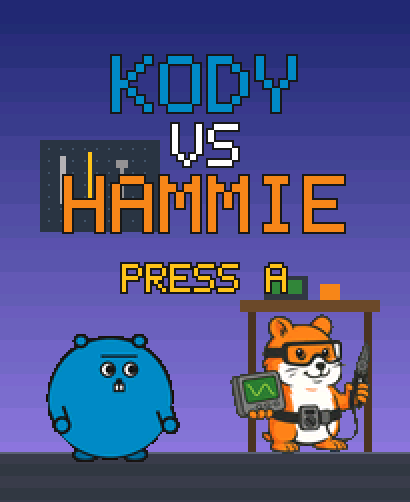
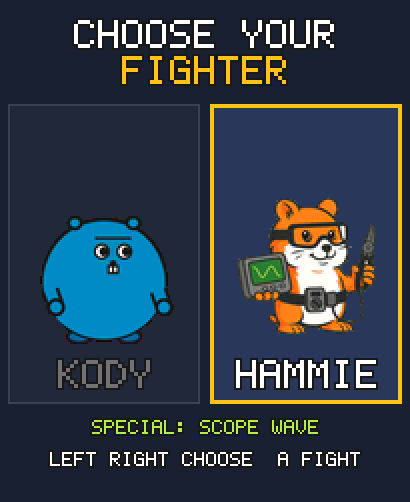
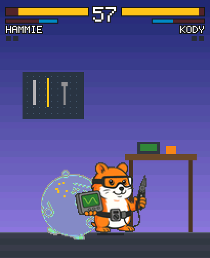

# Kody vs Hammie

A one-on-one fight for the Kode Dot between its two mascots: Kody, the blue hamster, and Hammie,
the orange one with goggles from the original sticker. Choose your fighter, the Dot plays the
other one. Best of three rounds, 60 seconds each.

> [!WARNING]
> **Not tested on an official Kode Dot yet.** It runs in kode-sim (Kode's own emulator), which
> passes its review: it installs, starts, plays at about 60 fps, goes home with BOT and does not
> crash. Nobody has played it on real hardware yet.

> [!NOTE]
> A fan project, not made or supported by Kode. Kody and Hammie are Kode's characters.

| Title | Choose your fighter | Fight |
|---|---|---|
|  |  |  |

## Controls

| Button | In the fight | In the menus |
|---|---|---|
| LEFT / RIGHT | walk | choose |
| UP | jump | |
| DOWN | block | |
| TOP (A) | punch; with DOWN held: kick; in the air: flying kick | confirm |
| BOT tap | special (costs half the energy bar) | back |
| BOT hold | home to kodeOS | home to kodeOS |

**Specials:** Kody throws his laptop; Hammie fires the wave off his scope. Two specials that meet
cancel out.

**Energy** (the thin bar under the health bar) fills when you hit, get hit or block.

**Power-ups** drop into the arena now and then. Walk into one to take it:

| | Power-up | Effect |
|---|---|---|
| battery | Battery | +50 energy: a special right away |
| coffee | Coffee | 6 s faster |
| iron | Soldering iron | 6 s harder hits (x1.5) |
| heart | Heart | +20 health |

## Install

Download `kody_vs_hammie.bin` from [Releases](https://github.com/Rein033/kody-vs-hammie/releases/latest), or build it (ESP-IDF v6.1; the first build fetches the kode SDK):

```bash
idf.py build
```

Install it over the USB cable with `kcli.py` from a clone of [KodeOS](https://github.com/kodediy/KodeOS):

```bash
python path/to/KodeOS/tools/kcli.py -p PORT install kody_vs_hammie.bin
```

It then shows up in Apps.

## How it is made

- `main/game.c`: the whole game in plain C (no SDK): the screens, the fight, the CPU fighter and
  the power-ups. It paints a 205 x 251 frame; `main/fight_ao.c` doubles it onto the glass at 60
  frames a second, like Kody Kart.
- `main/sprites_gen.h`: every pose of both fighters, made by `tools/gen_sprites.py`. Hammie is put
  together from the parts of his sticker (it needs the sticker image, which is not in this
  repository: `--ref reference.png`); Kody is drawn by the script.
- `host/host_main.c`: the game on a PC with scripted buttons, to test a whole match and write
  frames as pictures:

```bash
gcc -Imain host/host_main.c main/game.c main/font.c -lm -o fight && ./fight out 0
```

`main/font.c` and `main/sound.c` come from Kody Kart (GPL-3.0).

## Licence

GPL-3.0-or-later, like the kode SDK and Kody Kart (see `LICENSE` and `NOTICE.md`).
